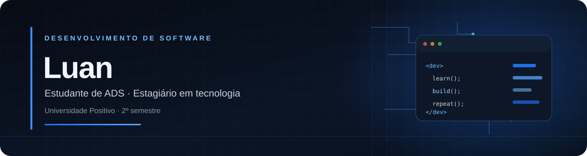
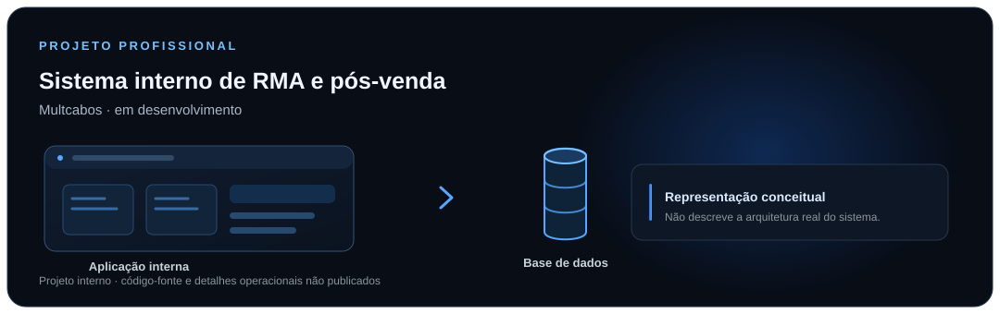

  

  <strong>DESENVOLVIMENTO DE SOFTWARE · APRENDIZADO NA PRÁTICA</strong> 
  Universidade Positivo · Análise e Desenvolvimento de Sistemas · 2º semestre

---

## Sobre mim

Sou estudante de Análise e Desenvolvimento de Sistemas na Universidade Positivo e estagiário na área de tecnologia. Tenho interesse em desenvolvimento de software e programação, e estou construindo experiência profissional por meio de projetos práticos.

## Tecnologias em estudo

<table>
  <tr>
    <td align="center" width="160">
       
      <strong>Python</strong> 
      Em estudo
    </td>
    <td align="center" width="160">
       
      <strong>JavaScript</strong> 
      Em estudo
    </td>
    <td align="center" width="220">
      <strong>IA</strong> 
      Área de interesse
    </td>
  </tr>
</table>

## Projeto em destaque

**Sistema interno de RMA e pós-venda · Multcabos**  
Projeto profissional em desenvolvimento

Participo do desenvolvimento de uma solução interna relacionada aos processos de RMA e pós-venda.

  

A ilustração é conceitual. Este repositório não publica código-fonte nem detalhes internos da empresa.

## GitHub Stats

  

  

## Contato

Para acompanhar meu trabalho e trocar experiências sobre tecnologia, acesse meu <a href="https://github.com/naskjz">perfil do GitHub</a>.

Londrina, Paraná · Em evolução contínua na área de tecnologia

