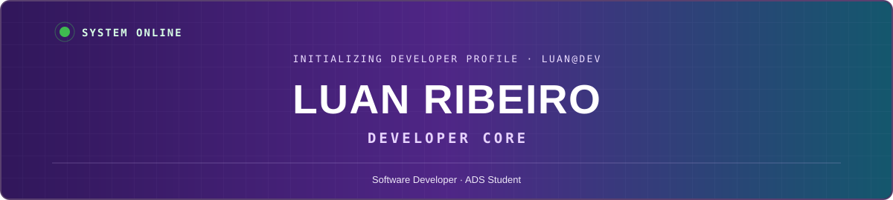
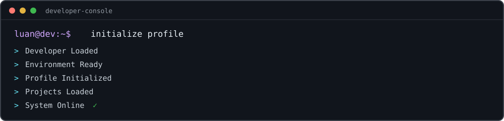
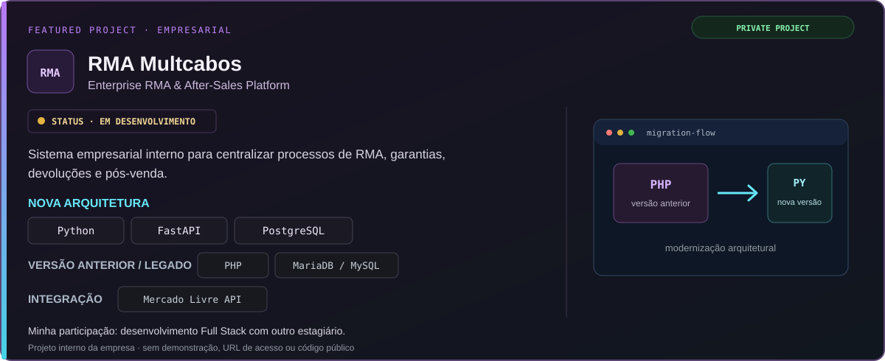
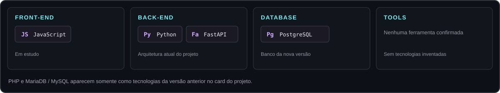
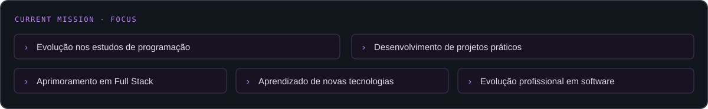
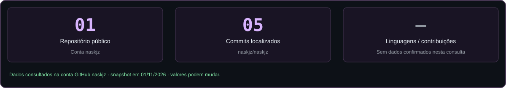

<div align="center">
  
</div>

## ⌘ AI Terminal

<p align="center">
  
</p>

## ▣ About Me

```javascript
const developer = {
  name: "Luan dos Santos Ribeiro",
  education: "ADS · Universidade Positivo · 2º semestre",
  role: "Software Developer | ADS Student",
  experience: "Estagiário em tecnologia",
  interests: ["Desenvolvimento de software", "Full Stack"],
  focus: "Aprendizado contínuo com projetos práticos"
};
```

## ▣ Featured Projects

<p align="center">
  
</p>

## ϟ Tech Stack

<p align="center">
  
</p>

<sub>IA · área de interesse</sub>

## ϟ Current Mission

<p align="center">
  
</p>

## ⌘ Developer Console

```text
luan@dev:~$ developer --summary
developer     Luan Ribeiro (@naskjz)
education     Análise e Desenvolvimento de Sistemas
institution   Universidade Positivo · 2º semestre
role          Estagiário na área de tecnologia
mission       Construir experiência prática em desenvolvimento de software
luan@dev:~$ _
```

## ▤ Skills

| Categoria | Tecnologias / contexto confirmado |
|:--|:--|
| Front-end | JavaScript · em estudo |
| Back-end | Python · FastAPI |
| Database | PostgreSQL |
| Legacy | PHP · MariaDB / MySQL · versão anterior do sistema |
| DevOps / Tools | Não informado |

## ▥ GitHub Analytics

<p align="center">
  
</p>

<sub>Snapshot do perfil público consultado em 01/11/2026. A distribuição de linguagens não está disponível nos dados consultados.</sub>

## ⌁ Contact

<a href="mailto:luandossantosribeiro916@gmail.com">E-mail profissional</a> · <a href="https://www.linkedin.com/in/luan-dos-santos-577922396/">LinkedIn</a>

<p><sub>Londrina, Paraná · Em evolução contínua na área de tecnologia</sub></p>
